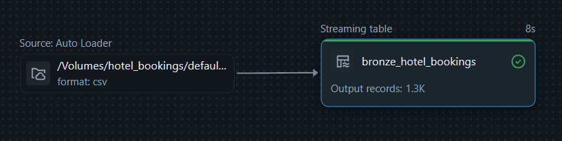
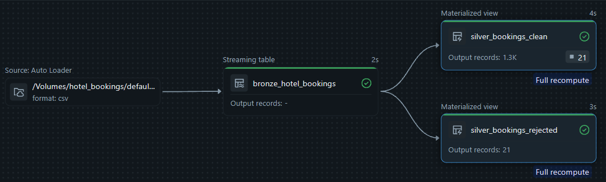
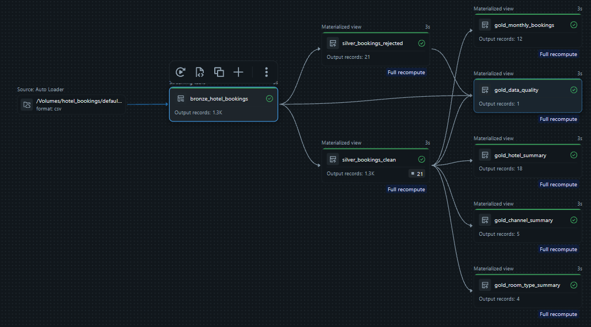
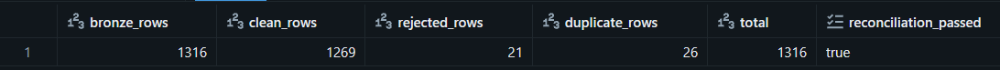
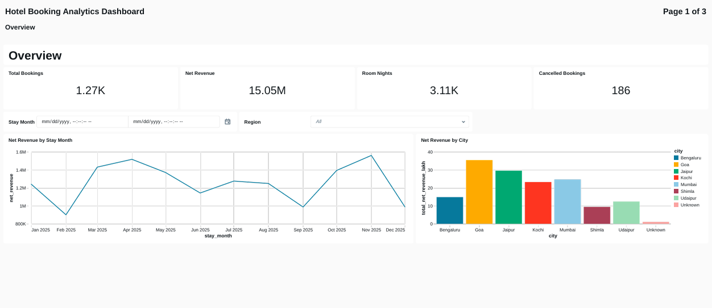
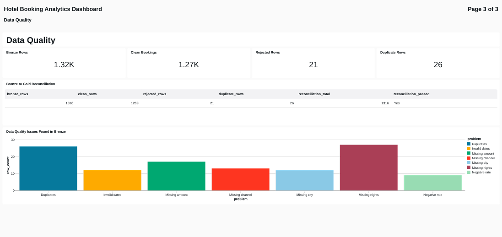

# Hotel Booking Analytics Platform

An end-to-end ETL pipeline I built during my Data Engineering Internship, using **SQL** and **Lakeflow Spark Declarative Pipelines** on **Databricks Free Edition**. It follows the Medallion Architecture (Bronze, Silver, Gold) and ends with a 3-page Databricks AI/BI dashboard.

## 1. Project Overview

A hotel group exports all its room bookings to a CSV file, and managers want reliable reports on bookings, revenue, room nights, hotels, room types and booking channels, including how many bookings are cancelled. I built a repeatable pipeline that keeps the raw file, cleans it step by step, creates business-ready summary tables, proves that no row was lost, and shows the results in a dashboard.

**Dataset:** `hotel_bookings_raw.csv`, a synthetic dataset (made up for learning) with 1,316 rows and 20 columns covering hotel stays in 2025.

**Problems I found and fixed:**
- Duplicate bookings
- Extra spaces and mixed capital letters in city, room type, booking channel and meal plan
- Blank city, booking channel, nights and total amount
- Check-out dates on or before check-in dates
- Negative room rates

## 2. Architecture

```
hotel_bookings_raw.csv  (Unity Catalog Volume)
          |
   BRONZE   bronze_hotel_bookings        raw data + source_file + loaded_at
          |
   SILVER   silver_bookings_clean        cleaned data (completed + cancelled)
            silver_bookings_rejected     bad rows + reject_reason
          |
   GOLD     gold_monthly_bookings
            gold_hotel_summary
            gold_room_type_summary
            gold_channel_summary
            gold_data_quality            row counts + reconciliation
          |
   Databricks AI/BI Dashboard (3 pages)
```

| Layer | What I did | Result |
|---|---|---|
| Bronze | Loaded the CSV as it is with Auto Loader and added the file name and load time | 1 streaming table |
| Silver | Removed duplicates, fixed text, filled blanks, and moved impossible rows to a rejected table | 1 clean table + 1 rejected table |
| Gold | Grouped the clean data by month, hotel, room type and channel, counting only Completed bookings as revenue | 4 summary tables + 1 data quality table |
| Dashboard | Built 3 pages on the Gold tables only | 1 dashboard |

## 3. Repository Structure

```
hotel-booking-analytics-etl/
├── README.md
├── data/
│   └── hotel_bookings_raw.csv
├── pipeline/
│   ├── 01_bronze.sql
│   ├── 02_silver.sql
│   ├── 03_gold.sql
│   └── 04_data_quality.sql
├── dashboard/
│   └── Hotel_Booking_Analytics_Dashboard.pdf
├── docs/
│   ├── cleaning_rules.md
│   └── review_answers.md
└── Screenshots/
```

## 4. How I Set It Up

1. I used Databricks Free Edition with a catalog named `hotel_bookings` and the schema `default`.
2. I created a managed volume named `raw_files`, which gives the path `/Volumes/hotel_bookings/default/raw_files/`.
3. I uploaded `hotel_bookings_raw.csv` into the volume.
4. I checked the upload with this query, which returned 1,316 rows:

```sql
SELECT COUNT(*) FROM read_files('/Volumes/hotel_bookings/default/raw_files/',
  format => 'csv', header => true);
```

5. I created an ETL pipeline named `hotel_bookings_pipeline` with the default catalog `hotel_bookings`, the default schema `default`, and SQL as the language.
6. I added the four SQL files from the `pipeline/` folder to the pipeline's `transformations` folder, inside `Bronze`, `Silver` and `Gold` subfolders.
7. I clicked **Run pipeline**. Databricks works out the order from the table dependencies, so the whole project runs with one click and gives the same result every time.

## 5. Pipeline Results

**Bronze:** the CSV loaded with 1,316 rows.



**Silver:** 1,269 bookings passed the quality checks and 21 rows were rejected and saved with a reason.



**Gold:** five Gold tables were built from the clean data, and the full pipeline ran with every step successful.



### Reconciliation

To prove that no row was lost, I checked that every Bronze row is accounted for:

**1,316 Bronze rows = 1,269 clean + 21 rejected + 26 duplicates removed**



## 6. Cleaning Rules

| Problem | What I did |
|---|---|
| Duplicate bookings | Kept one copy with `SELECT DISTINCT` |
| Extra spaces and mixed case | Used `INITCAP(TRIM(col))` on city, room type, booking channel and meal plan |
| Blank city or booking channel | Replaced with `Unknown` using `COALESCE` |
| Blank nights | Calculated with `DATEDIFF(check_out_date, check_in_date)` |
| Blank total amount | Calculated as nights x room rate |
| Check-out on or before check-in | Rejected with `EXPECT (check_out_date > check_in_date)` |
| Negative room rate | Rejected with `EXPECT (room_rate >= 0)` |
| Cancelled bookings | Kept in Silver, but excluded from revenue and room nights in Gold |

The full list with reasons is in [`docs/cleaning_rules.md`](docs/cleaning_rules.md).

## 7. Dashboard

I built a 3-page Databricks AI/BI dashboard on top of the Gold tables. A PDF copy is in the `dashboard/` folder.

### Page 1: Overview
Total Bookings, Net Revenue, Room Nights and Cancelled Bookings, plus net revenue by stay month and by city.



### Page 2: Hotels, Rooms & Channels
Net revenue by hotel, a hotel table with average daily rate, revenue and rating by room type, and cancellation rate by booking channel.


### Page 3: Data Quality
Bronze, clean, rejected and duplicate row counts, the reconciliation table, and the data quality issues found in Bronze.



## 8. Key Results

| Metric | Value |
|---|---|
| Clean bookings | 1,269 |
| Net revenue (completed stays only) | ₹1.51 Cr |
| Room nights | 3,107 |
| Cancelled bookings | 186 |
| Highest revenue city | Goa |
| Highest revenue room type | Deluxe |
| Reconciliation | Passed (1,316 = 1,269 + 21 + 26) |

## 9. Key Decisions I Made

- **One pipeline, not three.** Silver reads from Bronze and Gold reads from Silver, so a single pipeline lets Databricks run everything in the right order with one click.
- **Kept cancelled bookings in Silver.** Cancellation is a normal business event, and I need those rows to calculate the cancellation rate.
- **Counted revenue and room nights for Completed bookings only.** Cancelled stays do not earn revenue.
- **Calculated average daily rate as net revenue / room nights.** Averaging each booking's rate would give a 1-night stay the same weight as a 7-night stay.
- **Never added or averaged rates, ratings or percentages.** I show them per row only.
- **Left payment method untouched.** `INITCAP` would change `UPI` into `Upi`.

## 10. Tools Used

- Databricks Free Edition (Unity Catalog, Volumes, serverless compute)
- Lakeflow Spark Declarative Pipelines (SQL)
- Databricks SQL Editor
- Databricks AI/BI Dashboards

## 11. What I Learned

- How to treat valid business events, like cancellations, differently from real data errors
- How to calculate metrics like average daily rate and cancellation rate correctly
- Why reconciliation matters: it proves that cleaning didn't lose any data
- How to build a dashboard whose numbers match the Gold tables exactly

## Note on the Data

The dataset is synthetic (made up for this project). It contains no real guest or hotel data.
